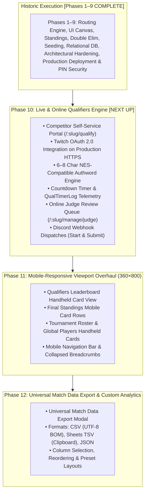

# Master Implementation Plan: Tournament Manager

This document is the consolidated, single source of truth for the implementation of **Tournament Manager** as specified in [SPEC.md / Tetris Tournament Manager.md](../Tetris%20Tournament%20Manager.md). It tracks completed execution, out-of-scope capabilities added along the way, and the prioritized roadmap for all remaining work.

---

## 1. Master Roadmap & Global Status (Phases 1–12)

| Phase | Title | Status | Description |
| :--- | :--- | :--- | :--- |
| **Phase 1** | Core Routing Engine | **Complete** | Mathematical Single-Elimination & Flat routing, bye invariants ($N - 1$ matches). |
| **Phase 2** | Reactive UI & Match Recording | **Complete** | Canvas visualizer, drawer score entry, multi-game tracking, Best-of-X overrides. |
| **Phase 3** | In-Memory Pipeline & Refinements | **Complete** | Mode unification (`isLocked`), global standings, maxout logic, global player catalog. |
| **Phase 4** | Tournament Organizations | **Complete** | Organization directory (`/organizations`), org branding & default rules inheritance, raw metric indexing. |
| **Phase 5** | Double Elimination Bracket Engine | **Complete** | Double elim (Winners, Losers, Grand Finals Reset), Accelerated Hybrid multi-pod layout, player journey search. |
| **Phase 6** | Direct / Manual Seeding & Bulk Import | **Complete** | Qual-less tournament seeding, multiline paste import, drag/drop reordering, tier dividers, direct bracket generation. |
| **Phase 7** | Relational Database & API Backend | **Complete** | PostgreSQL (Neon/Docker) + Drizzle ORM, REST API middleware, authentic player pool (1,620 competitors). |
| **Phase 8** | Architectural Hardening & Tournament Rules | **Complete** | Decoupled domain hooks, canonical defaults, CLI seeder, 415 automated tests, bye seed alternation (1 vs N), points qual 0-pt tiebreaker, OBS draft overlays. |
| **Phase 9** | **Production Cloud Deployment, MatchFoundry™ Brand Launch & CI/CD** | **Complete** | Vercel Serverless runtime (`api/index.ts`), Neon cloud PostgreSQL migration, MatchFoundry™ rebrand & strategic trademark rollout, zero runtime git artifacts, and Branch/PR CI/CD deployment gating. |
| **Phase 10**| **Live & Online Qualifiers Engine** | **Upcoming (Phase 10)** | Competitor self-service portal (`/:slug/qualify`), Twitch OAuth 2.0 on production HTTPS, 6–8 char NES Authwords, countdown telemetry, judge review queue, Discord webhooks. |
| **Phase 11**| **Mobile-Responsive Viewport Overhaul (360×800)** | **Upcoming (Phase 11)** | Handheld 360×800 dense table card views (Leaderboard, Standings, Roster, Global Players), collapsed mobile nav & breadcrumbs. |
| **Phase 12**| **Universal Match Data Export & Custom Analytics** | **Upcoming (Phase 12)** | Universal match data export (CSV with UTF-8 BOM, Google Sheets TSV clipboard copy, JSON) with custom column selection and reordering. |

---

## 2. Completed Phases & Historic Execution

### Phase 3: Unified In-Memory Pipeline, Adaptive Qual Board & Operational Polish [COMPLETE]
* **Priority 1: UI Rebranding, Ergonomics, Modal Guards & Mode Terminology:**
  * Rebranded UI to "Tournament Manager" (removed all legacy "CTWC" references).
  * Unified mode terminology: "Qualifiers Mode" (`isLocked === false`) vs "Match Play Mode" (`isLocked === true`).
  * Locked down match cards in `BracketVisualizer`, `OrganizerSheetMatrix`, and `MatchCardFeed` during Qualifiers Mode.
  * Disabled backdrop dismissal on `MatchScoreDrawer`, `PlayerDetailDrawer`, and `QualifierEntryModal`.
  * Added dirty state tracking to `TournamentAdminForm` ("Save Configuration" disabled until dirty) with unsaved changes navigation guard modal.
  * Bound tier colors dynamically (`primaryColor`, `secondaryColor`) to round badges, borders, winner highlights, and trophy icons.
* **Priority 2: Tournament Lifecycle & Simulation Controls:**
  * Replaced legacy `isVerified` and `qualsClosed` with single source of truth `isLocked: boolean`.
  * Enforced unlock safety invariant: blocking unlock if any match has recorded scores.
  * Clean-slate defaults on fresh onboarding (0 tournaments on home switcher; modal routes to `/:slug/manage/settings` with 0 data).
  * Data Management controls in Settings: "Seed Qualifiers Only" (bracket capacity + 4 DNQs), "Simulate Full Tournament" (complete match outcomes to champions), and "Clear All Tournament Data" (guarded by red speedbump confirmation modal). Purged legacy demo pipelines.
* **Priority 3: Global Tournament Standings & Competitive Exit Tiebreakers:**
  * Refactored `standings.ts` to output a unified #1 to #N global list across all tiers.
  * Implemented exact intra-round exit tiebreaker formula (exit game wins $\rightarrow$ loss avg $\rightarrow$ match record $\rightarrow$ game avg $\rightarrow$ seed).
  * Continuous `FinalStandingsTable.tsx` with overview stat cards, performance analytics columns, and Qual vs. Final rank delta badges.
* **Priority 4: Qualifiers Table Density & Competitor Detail Drawer:**
  * Implemented Maxout count ($\ge 999,999$) + kicker score sorting hierarchy in `scoring.ts`.
  * Format-dense column rendering on `LeaderboardTable.tsx` adapting to `HIGH_SCORE`, `AVERAGE_OF_X`, and `POINTS`.
  * Slide-out `PlayerDetailDrawer.tsx` displaying competitor profile, chronological qualifier submission audit log, and match breakdown.
* **Priority 5: Global Player Pool Directory & Tournament Roster:**
  * Master player directory under LocalStorage key `classic_tetris_global_players` at `/players`.
  * "Generate Fake Players" prompt modal with presets (`+8`, `+16`, `+32`, `+64`) generating realistic competitors.
  * Tournament roster registration with "Import from Global Pool" and "Import All Available" actions.
* **Priority 6: Accelerated Hybrid Layout, Player Journey Highlighting & Operational Polish:**
  * Accelerated Hybrid multi-pod layout: side-by-side Fit/Split views, scrollbar elimination in Pod 2, Pod 3 match centering, and responsive single-column collapse.
  * Competitor search input in `BracketTierBar` with auto-complete and zero-lag Player Journey SVG path illumination.
  * Double Elimination judge feed filtering: resolved stage filter desynchronization, unique round keys, and tier-switching remounting hygiene (`key={tier.id}`).
  * Established permanent automated regression test mandate in `AGENTS.md`.

---

### Phase 6: Direct / Manual Seeding & Roster Seeding Engine [COMPLETE]
* **Objective:** Enable tournament organizers to seed tournaments directly without requiring qualifier submissions, supporting invitationals, pre-ranked community events, and blind-draw tournaments.
* **Delivered Capabilities:**
  * **Seeding Mode Toggle:** Introduced `seedingMethod: 'QUALIFIERS' | 'MANUAL'` on `Tournament` with settings toggle in `TournamentAdminForm`. Qual-specific fields cleanly collapse when in manual mode.
  * **Bulk Seed Import (`BulkSeedImportModal.tsx`):** Large multiline paste modal. Parser strips bullets, numbering (`1. `, `#1 `, `- `), trims whitespace, and automatically resolves names against tournament rosters and the global player catalog.
  * **Interactive Seeding Manager (`ManualSeedingManager.tsx`):** Dedicated management view with drag-and-drop handles, Move Up/Down/Top/Bottom buttons, direct seed number assignment, reverse order, and Fisher-Yates random shuffle (with confirmation speedbump).
  * **Dynamic Tier Boundary Dividers:** Visual tier cutoff banners (Gold Tier, Silver Tier, Reserves/Alternate pool) rendered directly across the manual seed list.
  * **Bracket Generator Hook:** `generateDraftBracketsForTournament` directly bypasses `deriveLeaderboard` when in manual mode and distributes `manualSeeds` across tier capacities.
  * **Standings & Simulation Integration:** Computes `rankDelta` relative to assigned manual seeds; adapts simulation controls to generate realistic manual seedings.
  * **Automated Regression Suite:** 10 comprehensive tests in `src/features/tournament/__tests__/manualSeeding.test.ts`.

---

### Phase 7: Relational Database & Server API Backend [COMPLETE (FOUNDATION)]
* **Objective:** Transition `tournament-manager` from ephemeral client-side LocalStorage to a persistent relational database with server API routes.
* **Delivered Capabilities:**
  * **PostgreSQL Schema (`src/db/schema.ts`):** Complete relational models with foreign key constraints, cascading deletes, and indexes:
    * `organizations`: Organization identity, branding, theme colors, tier themes, default rules.
    * `players`: Competitor identity with `lower(trim(name))` uniqueness index, country, playstyle, PB, notes.
    * `tournaments`: Tournament identity, organization FK, qual format, points config, `is_locked`, metadata.
    * `bracket_tiers`: Tier configuration, tournament FK, priority order, bracket type, colors, metadata.
    * `tournament_players`: Roster assignments, player FK, tier FK, seed, qual completion status.
    * `qualifier_submissions`: Scores, timestamps, player FK, tournament FK.
    * `matches` & `games`: Relational match play tracking, game scores, Best-of-X, forfeit flags, winner/loser FKs.
  * **Database Infrastructure:** Docker compose environment (`docker-compose.yml`) running PostgreSQL 16 on port 5433, with Drizzle Kit push migrations (`npm run db:push`) and Drizzle Studio (`npm run db:studio`).
  * **Server API Middleware (`src/server/api.ts`):** Vite dev server API middleware supporting:
    * `/api/organizations`: Org CRUD, detail lookup by ID/slug, default rules sync.
    * `/api/tournaments`: Full tournament creation, retrieval, updates, and deletion.
    * `/api/players`: Player CRUD, directory lookups, search.
    * `/api/tournaments/:id/qualifiers`: Atomic score submission and batch qualifiers ingestion.
    * `/api/tournaments/:id/matches`: Match score recording and resets.
    * `/api/simulate/sample`: 1-click sample tournament generation.

---

### Out-of-Scope Capabilities Delivered Along the Way [COMPLETE]
* **1,620 Authentic Competitor Seed Dataset (`scripts/importPlayers.ts`):**
  Imported 1,620 real-world competitive Classic Tetris competitors with authentic names, randomized realistic countries, playstyles (Rolling, DAS, Hypertap), and personal bests (750k–1.4M) into PostgreSQL.
* **Cross-Platform CLI Compatibility:**
  Hardened database scripts, `drizzle.config.ts`, and Node execution hooks for seamless Windows PowerShell and POSIX execution.
* **Drizzle Studio Navigation Architecture:**
  Integrated schema relationships enabling Drizzle Studio's virtual navigation badges between parents and children (`bracket_tier`, `games`, `tournament`).

### Phase 8: Architectural Hardening, Domain Decoupling & Tournament Rules [COMPLETE]
* **Objective:** Eliminate monolithic state bottlenecks, decouple domain hooks, establish canonical entity factories, introduce fast test suites, and resolve all mathematical and lifecycle edge cases across 415 passing automated regression tests.
* **Delivered Capabilities:**
  * **Domain Hooks Decoupling:** Created independent domain hooks in `src/features/tournament/hooks/` (`useTournamentSettings`, `useQualifiers`, `useMatches`, `useGlobalPlayers`) with index re-exports and backward-compatible bindings in `store.tsx`.
  * **Single Entity Factory & Defaults (`src/features/tournament/defaults.ts`):** Canonical factories `createEmptyTournament()`, `createDefaultTier(priority)`, and `createEmptyPlayer()` implemented and adopted in `TournamentAdminForm.tsx` and `CreateTournamentModal.tsx`.
  * **Dedicated CLI Database Seed Script (`npm run db:seed`):** Standalone cross-platform script `scripts/seed.ts` seeding default organizations, 1,620 authentic competitors, and sample tournaments directly via Drizzle into PostgreSQL.
  * **Contract Alignment & Strict Type Invariants:** Eliminates loose `Record<string, any>` types with strict `TournamentMetadata`, `TierMetadata`, `OrganizationBranding`, and `OrganizationDefaultRules` in `types.ts` and `schema.ts`. Hardens `TierInput` and `TierRecord` to defensively support both `playerCount` and `numPlayers` and align `BracketRouting` with `TRADITIONAL_TREE`.
  * **Targeted Fast-Feedback NPM Test Scripts:** Added `npm run test:brackets` (~2.6s), `npm run test:api` (~5.5s), and `npm run test:ui` (~3.1s) to `package.json`.
  * **Agent Architecture Index:** Added Domain File Map and updated verification commands in `AGENTS.md`.
  * **Flat Bracket Bye Seed Alternation (1 vs N):** Updated `seed-utils.ts`, `flat.ts`, and `double-elimination.ts` so byes follow standard competitive tournament bracket alternation: highest seeds receive byes and face the lowest surviving seeds ($1 \text{ vs } N, 2 \text{ vs } N-1$), ensuring Seeds 1 and 2 only meet in the Finals.
  * **Points Qualifier Tiebreaker for 0-Point Players:** Updated `scoring.ts` to compute each player's highest single game score (`peakScore`) and sort descending as the primary tiebreaker for players with 0 points (and tied point totals).
  * **Simulation & Data Management Safety Hierarchy:** In `DataSimulationSection.tsx` and `TournamentAdminForm.tsx`, disabled and blocked "Clear Quals" whenever active match scores exist. Enforced the strict lifecycle hierarchy: "Clear Matches" must be executed before "Clear Quals" becomes enabled.
  * **Settings 'Add Tier' Button Placement:** Positioned the "+ Add Tier" button at the bottom of the tiers list when 1 or more tiers exist (retaining it prominently in the empty state when 0 tiers exist).
  * **Homepage Tournament Card Navigation to Admin Bracket View:** Routed homepage card "Brackets" action button and tier pill links directly to the admin management bracket view (`/:slug/manage/bracket/${tier.slug}`).
  * **Global Player Card Identity:** Extended `PlayerProfile`, database schema `players` table, API layer, `PlayerEditModal.tsx`, `PlayerDetailDrawer.tsx`, and `PlayerDirectory.tsx` with `displayName`, `nickname`, and `twitchUsername` (sanitizing `@` prefix and providing Twitch stream badges).
  * **Pre-Lock Bracket Visibility in OBS Overlays:** Created `ObsBracketView.tsx`, `ObsMatchCardView.tsx`, and `ObsOverlayPage.tsx` supporting draft bracket preview mode when `tournament.isLocked === false` with chroma key support (`?chroma=green|#hex`), generating draft/projected match nodes with live qualifier seeds or placeholder seeds and displaying a pulsing "DRAFT PREVIEW" header badge.
  * **Automated Regression Suite:** 12 tests in `src/features/tournament/__tests__/domainHooksAndDefaults.test.ts` and 7 tests in `src/features/tournament/__tests__/tournamentRulesAndLifecycleRegression.test.ts`.

---

## 3. Prioritized Implementation Roadmap (Remaining Work)

---

### Phase 9: Production Cloud Deployment, MatchFoundry™ Brand Launch & CI/CD [COMPLETE]
* **Goal:** Deliver a fully deployed, production-grade tournament management platform on the public web (`matchfoundry.gg` on Vercel + Neon PostgreSQL), fortified by multi-tier PIN access security, a strategic MatchFoundry™ rebrand with common-law trademark protections, and a gated Branch/PR CI/CD delivery pipeline.

* **Track 9A: Multi-Tier PIN Security Engine [COMPLETE]**
  1. **Security Hierarchy:**
     * **Level 0 (Public / Spectator):** Frictionless read-only access to public views (`/:slug/brackets`, `/:slug/quals`, `/:slug/standings`, `/:slug/qualify`, OBS overlays). Protected routes redirect to PIN login.
     * **Level 1 (Tournament Admin):** Scoped by per-tournament PIN (`admin_pin_encrypted`). Unlocks management left-nav (`/:slug/manage/*`). Unauthorized navigation to global admin views bounces to admin login.
     * **Level 2 (Master / System Admin):** Authenticated via Master PIN or immutable environment fallback `SYSTEM_ADMIN_RECOVERY_PIN`. Grants global access across all tournaments, organizations, and player catalogs.
  2. **Data Management & Simulation Isolation:**
     * Destructive simulation controls ("Clear All Tournament Data", "Simulate Full Tournament", "Seed Qualifiers Only") and bulk endpoints (`/api/simulate/sample`) are strictly hidden and restricted to System Admins. Tournament Admins cannot view or trigger data wipe operations.
  3. **AES-256-GCM Two-Way Encryption (`pinCrypto.ts`):**
     * Encrypts tournament PINs at rest using secret `PIN_ENCRYPTION_KEY`, allowing System Admins to safely reveal PINs (`👁️ 7492`) without invalidating active sessions.
  4. **Signed Session Tokens & API Route Guards:**
     * Signed 7-day tokens verified by `createApiMiddleware()` on all mutation methods (`POST`, `PUT`, `DELETE`).

* **Track 9B: Production Cloud Infrastructure & Serverless Bundler [COMPLETE]**
  1. **Neon Serverless PostgreSQL:** Provisioned and migrated schema across all 9 relational tables; connected via `@neondatabase/serverless` connectionless HTTP driver (`drizzle-orm/neon-http`).
  2. **Standalone Serverless Bundler Pipeline:** Transitioned serverless API entry point from temporary build bundle to pure TypeScript `api/index.ts` transpiled on the fly by `@vercel/node`.
  3. **Vercel SPA & API Routing:** Configured `vercel.json` rewrites routing `/api/(.*)` to the serverless function and all other routes to `dist/index.html` with `x-matched-path` header normalization.
  4. **Custom Domain & DNS:** Live on custom domain `https://www.matchfoundry.gg` via Cloudflare DNS and Vercel Edge Network.

* **Track 9C: MatchFoundry™ Brand Identity & Trademark Rollout [COMPLETE]**
  1. **Strategic Trademark (`™`) Placement:**
     * Assert common-law trademark rights on primary anchors without cluttering body text:
       * Primary header logo: `MATCH` + gold `FOUNDRY` + superscript `™` in `TopNavSwitcher.tsx` and `TournamentSidebar.tsx`.
       * Page title: `<title>MatchFoundry™ | Tournament Command Center</title>` in `index.html`.
       * Hero & login subtitle: `MatchFoundry™ Access Control` in `AdminLoginPage.tsx` and `TournamentSwitcherPage.tsx`.
       * Subtle footer/legal line: `© 2026 MatchFoundry™. All rights reserved.` in `TournamentSwitcherPage.tsx` and `AdminLoginPage.tsx`.
  2. **Package & Metadata Unification:**
     * Updated `package.json` and `package-lock.json` name from `tournament-manager` to `matchfoundry`.
     * Updated Discord webhook test dispatches in `OrganizationDashboard.tsx`.
     * Added automated brand verification test suite in `src/components/__tests__/rebrand.test.tsx`.

* **Track 9D: Gated Branch/PR CI/CD Pipeline & Zero-Artifact Git Hygiene [COMPLETE]**
  1. **Zero Built Artifacts in Git & Dynamic Serverless Bundler:**
     * Purged the temporary compiled bundle `api/index.js` from git tracking.
     * Added `api/*.js` to `.gitignore` so runtime build artifacts can never be committed.
     * Maintained `src/server/serverless.ts` as pure TypeScript source code.
     * Wired `build:api` into `npm run build` (`"build": "tsc --noEmit && vite build && npm run build:api"`), bundling `src/server/serverless.ts` on-the-fly into `api/index.js` during both CI and Vercel cloud deployments without dirtying Git.
  2. **Trunk-Based PR Workflow:**
     * Dedicated feature branch: `feature/matchfoundry-rebrand-and-cicd` $\rightarrow$ Pull Request to `main`.
     * Automated GitHub Actions CI workflow triggered on PR:
       * `npm run typecheck`
       * `npm test` (full Vitest suite: 43 test files, 494 passing tests)
       * `npm run build` (pure client bundle verification)
     * Vercel automated preview deployments for live browser verification before merge.
  3. **Production Deployment Gate:**
     * Vercel production deployment triggers strictly upon merging PR into `main` after all CI status checks pass.
     * Prevents untested or breaking changes from ever landing on production `main`.
  4. **Local/Cloud Isolation Verification:**
     * Local development remains cleanly bound to Docker PostgreSQL (port 5432) with git-ignored `.env`, while Vercel production connects exclusively to Neon via dashboard secrets.
     * Golden journeys smoke tests passing cleanly in Playwright (`npm run test:e2e`).

---

### Phase 10: Live & Online Qualifiers Engine [UPCOMING]
* **Goal:** Deliver the full online self-service competitor qualification portal per Master Spec Section 10, running directly against the deployed production HTTPS environment (`matchfoundry.gg` on Vercel + Neon PostgreSQL), complete with robust identity resolution, Twitch OAuth 2.0, NES Authwords, and mixed-mode adjudication.

* **Track 10A: Relational Database Schema & Data Models (`src/db/schema.ts`, `src/features/tournament/types.ts`)**
  1. **Player Identity Extensions (`players` table):**
     * `twitch_id`: `text` (unique index, nullable) — Permanent, immutable Twitch account ID.
  2. **Qualifier Submissions Overhaul (`qualifier_submissions` table):**
     * `submission_source`: `text` enum (`'IN_PERSON'`, `'ONLINE'`, default `'IN_PERSON'`).
     * `auth_word`: `text` (nullable) — Assigned 6–8 character NES verification word.
     * `twitch_vod_url`: `text` (nullable) — Deep-link to competitor's stream broadcast.
     * `submitted_twitch_id`: `text` (nullable) — Immutable audit record of the authenticated Twitch account.
     * `submitted_twitch_username`: `text` (nullable) — Snapshot of Twitch handle at submission time.
     * `identity_status`: `text` enum (`'VERIFIED_MATCH'`, `'CLAIMED_PENDING_REVIEW'`, `'PROVISIONAL_NEW'`).
     * `status`: `text` enum (`'NOT_STARTED'`, `'IN_PROGRESS'`, `'SUBMITTED'`, `'VERIFIED'`, `'DNQ'`, `'DQ'`).
     * `timer_log`: `jsonb` (`QualTimerLog`: `startedAt`, `submittedAt`, `elapsedSeconds`, `pauses`).
     * `judge_notes`: `text` (nullable) — Adjudicator audit comments and timestamps.
     * `verified_by`: `text` (nullable) — Judge user identifier.
     * `verified_at`: `timestamp` (nullable).
  3. **Tournament Mixed-Mode Config (`tournaments` table):**
     * `qual_mode`: `text` enum (`'IN_PERSON'`, `'ONLINE'`, `'HYBRID'`, default `'HYBRID'`).
     * `qual_window_minutes`: `integer` (default 90).
     * `custom_auth_words`: `jsonb` (`string[]`).

* **Track 10B: Twitch OAuth 2.0 Integration & Identity Resolution Engine**
  1. **OAuth 2.0 Production Handshake:**
     * Dedicated endpoints: `/api/auth/twitch/authorize` and `/api/auth/twitch/callback` with PKCE / state CSRF validation.
     * Local dev fallback mock authentication for isolated Vitest/development without live Twitch credentials.
  2. **3-Tier Identity Resolution Protocol:**
     * **Tier 1 (Verified Repeat Competitor):** `players.twitch_id = session.twitch_id` $\rightarrow$ 100% confidence, auto-linked as `VERIFIED_MATCH`.
     * **Tier 2 (Roster Claim):** Unlinked competitor claims an existing tournament roster profile $\rightarrow$ `CLAIMED_PENDING_REVIEW` (unblocks competitor run immediately, requires judge ratification).
     * **Tier 3 (Provisional New Player):** Walk-in competitor registers new competitive alias, country, and playstyle $\rightarrow$ `PROVISIONAL_NEW`.

* **Track 10C: NES Authword Generator & Telemetry Engine (Spec Sec 10.2, 10.3)**
  1. **NES Character Set Enforcer:**
     * Strict validation against NES Tetris high-score charset: `A–Z`, `0–9`, `.`, `-`, `!`, `♥` (length: 6–8 chars; spaces strictly forbidden).
  2. **Curated Dictionary Engine:**
     * Curated dictionary of ~1,000 family-friendly English words ($\ge 6$ letters).
     * Seamlessly merges tournament-specific `custom_auth_words`.
  3. **Non-Blocking Telemetry Countdown Timer:**
     * React countdown timer inheriting `qualWindowMinutes`.
     * Non-blocking architecture: expiry logs over-time telemetry without disabling submit button.
     * Captures `QualTimerLog` telemetry (`startedAt`, `submittedAt`, `elapsedSeconds`, `pauses`).

* **Track 10D: Competitor Self-Service Portal (`/:slug/qualify`)**
  1. **3-Tier Component Architecture:**
     * Tier 1: Route Gate (`src/routes/PublicQualifyPage.tsx`).
     * Tier 2: Keyed Feature View (`src/features/online-quals/components/CompetitorPortalView.tsx`).
     * Tier 3: Pre-flight briefing modal, active session HUD, Authword display, submission form.
  2. **Session Lifecycle:**
     * Pre-flight checklist confirming live broadcast and Twitch past broadcast storage.
     * Session launch, active Authword HUD, game score entry, VOD URL paste.
     * "I'm Done" confirmation card with instant provisional leaderboard placement (`[⏳ Awaiting Verification]`).
  3. **Technical Exception Handling:**
     * "Report Stream Crash / Request Reset" action allowing competitors to request an authorized session void/restart from judges.

* **Track 10E: Mixed-Mode Adjudication & Identity Resolution Queue (`/:slug/manage/review`)**
  1. **Dedicated Review Queue Interface:**
     * Accessible via `/:slug/manage/review` with pending submission counter badge in navigation sidebar.
  2. **Identity Resolution & Override Actions:**
     * **"Confirm Identity Binding":** Permanently writes `twitch_id` to the claimed player's global profile.
     * **"Reassign / Link to Different Player":** Roster and global catalog search to correct mistaken claims.
     * **"Promote to Global Player":** Instantly creates a canonical row in `players`, imports to tournament roster, and verifies qualification.
  3. **Submission Adjudication:**
     * Embedded Twitch VOD player with timestamp scrub for 10k topout Authword verification.
     * Timer log elapsed time validation.
     * Action buttons: "Verify Qual", "Edit Score & Verify", "Mark DNQ", "Disqualify (DQ)".

* **Track 10F: Discord Webhook Dispatches & Mixed-Mode Leaderboard Polish**
  1. **Automated Discord Webhooks:**
     * Qual Start: `"🎮 [Player] started an official qual for [Tournament]! Watch live: [Twitch URL]"`
     * Qual Submit: `"🏆 [Player] submitted qual: [Score] avg. VOD: [Twitch VOD URL]"`
     * Qual Verified: `"✓ [Player]'s qualification has been verified by judge: [Score]"`
  2. **Unified Leaderboard Enhancements (`LeaderboardTable.tsx`):**
     * Multi-source pills: `[All]`, `[🏢 In-Person]`, `[🌐 Online]`, `[⏳ Pending Review]`.
     * Source indicator badges and clickable VOD icons for remote runs.

* **Track 10G: Automated TDD Regression Suite & User Journey Assertions**
  * **TDD Invariant & Definition of Done:** Development follows strict Acceptance-Test-Driven Development (ATDD). High-level journey assertions are codified in automated tests before component implementation; a track is complete only when its corresponding journey tests pass with zero regressions.
  
  1. **Journey 1 Assertions: The Online Competitor Portal (`src/features/online-quals/__tests__/competitorJourney.test.tsx`):**
     * *Assertion 1.1 (OAuth Gate):* Unauthenticated navigation to `/:slug/qualify` displays the Twitch Connect action; valid OAuth session resolves handle, avatar, and channel link.
     * *Assertion 1.2 (Identity Disambiguation):* Unmatched Twitch accounts present the dual choice modal (claim pre-registered tournament profile vs. register new alias); selecting either does not block starting the run.
     * *Assertion 1.3 (Authword Generation & Charset):* Initiating run generates an immutable 6–8 char Authword matching regex `/^[A-Z0-9.\-!♥]{6,8}$/` (no spaces).
     * *Assertion 1.4 (Timer Telemetry):* Non-blocking countdown initiates at `qualWindowMinutes`; expiring timer keeps submit active while recording over-time telemetry.
     * *Assertion 1.5 (Persistence):* Page reloads or tab closures during an active run cleanly recover active Authword and remaining elapsed time without resetting session.
     * *Assertion 1.6 (Submission Lockout & Provisional Impact):* Submitting valid scores + Twitch VOD link locks inputs to read-only, generates a confirmed receipt card, and immediately places the competitor on `/:slug/leaderboard` with status `[⏳ Awaiting Verification]`.

  2. **Journey 2 Assertions: Mixed-Mode Adjudication & Ingestion (`src/features/online-quals/__tests__/mixedModeAdjudication.test.tsx`):**
     * *Assertion 2.1 (Ingestion Source Separation):* Scores recorded via `QualifierEntryModal` save with `submission_source = 'IN_PERSON'`, `is_verified = true`, `status = 'VERIFIED'`; portal scores save with `submission_source = 'ONLINE'`, `is_verified = false`, `status = 'SUBMITTED'`.
     * *Assertion 2.2 (Review Queue Badge):* Tournament sidebar dynamically reflects the exact count of pending online submissions (`Review Queue (N)`).
     * *Assertion 2.3 (Adjudication Actions):*
       * Clicking *"Verify Qual"* flips status to `VERIFIED`, decrements queue badge, and changes leaderboard status to `✓ Verified`.
       * Clicking *"Edit Score & Verify"* mutates the recorded score, writes an audit log to `judge_notes`, and verifies.
       * Clicking *"Mark DNQ"* marks `status = 'DNQ'`, retains audit record, and excludes player from bracket seed calculation.
       * Clicking *"Disqualify (DQ)"* sets `is_disqualified = true` on the player profile.

  3. **Journey 3 Assertions: Identity Binding & Overrides (`src/features/online-quals/__tests__/identityResolution.test.tsx`):**
     * *Assertion 3.1 (Confirm Binding):* Confirming a `CLAIMED_PENDING_REVIEW` submission permanently writes `players.twitch_id = session.twitch_id`. Subsequent logins with that Twitch ID auto-resolve as `VERIFIED_MATCH`.
     * *Assertion 3.2 (Judge Reassign):* Reassigning a submission from Player A to Player B updates `qualifier_submissions.player_id` and shifts leaderboard scores accordingly.
     * *Assertion 3.3 (Promote Provisional New Player):* Confirming a `PROVISIONAL_NEW` competitor inserts a permanent row into `players`, creates `tournament_players` registration, and attaches the submission.

  4. **Journey 4 Assertions: Technical Crash & Session Reset (`src/features/online-quals/__tests__/sessionReset.test.tsx`):**
     * *Assertion 4.1 (Reset Request):* Competitor experiencing a crash during `IN_PROGRESS` can dispatch a reset request with explanation notes.
     * *Assertion 4.2 (Judge Void Action):* Adjudicator clicking *"Void & Issue New Authword"* clears active session timer log and generates a clean Authword, allowing the competitor to restart without duplicate submissions.

  5. **Journey 5 Assertions: Qualifiers Cutoff & Bracket Locking (`src/features/tournament/__tests__/qualsCutoffLifecycle.test.tsx`):**
     * *Assertion 5.1 (Gated Closure):* Attempting to close qualifiers while unverified submissions remain triggers a blocking confirmation alert.
     * *Assertion 5.2 (Locked Public Portal):* Setting `quals_closed = true` disables run initiation on `/:slug/qualify` and shows a "Qualifying Closed" announcement.
     * *Assertion 5.3 (Draft Bracket Seeding Integrity):* Auto-seeded bracket draft includes all verified players and strictly excludes players marked `DNQ` or `AWAITING_VERIFICATION`.

  6. **Golden Journey 4 (Playwright E2E — `e2e/golden-journeys.spec.ts`):**
     * End-to-end browser walkthrough: Remote competitor lands on `/omen-das/qualify` $\rightarrow$ authenticates via mock Twitch OAuth $\rightarrow$ receives Authword $\rightarrow$ submits scores + VOD link $\rightarrow$ verifies provisional leaderboard appearance $\rightarrow$ logs in as Tournament Admin $\rightarrow$ opens Review Queue $\rightarrow$ clicks "Verify Qual" $\rightarrow$ confirms public leaderboard updates to official verified standing.

---

### Phase 11: Mobile-Responsive Viewport Overhaul (360×800 Viewport) [UPCOMING]
* **Goal:** Guarantee all data-dense views are fully readable and operational on smartphone screens without horizontal scroll clipping per Master Spec Section 11.2 / 13.2.
1. **Qualifiers Leaderboard:** Compact mobile card/accordion view displaying Rank, Player, Playstyle, Status, and Attempts/Scores.
2. **Final Standings:** Mobile card rows preserving Final Rank, Competitor, Seed Delta badge, and Stage Reached.
3. **Tournament Roster & Global Players Directory:** Handheld cards for player management and search.
4. **Global Navigation & Header:** Hamburger menu / mobile bottom tab bar and collapsed breadcrumbs on viewports $< 768\text{px}$.

---

### Phase 12: Universal Match Data Export & Custom Analytics [UPCOMING]
* **Goal:** Finalize export pipelines and reporting tools per Master Spec Section 11.
1. **Universal Match Data Export Modal:**
   * Configurable column toggles (Tournament, Tier, Stage, Round, Players, Seeds, Game Scores, Winner, Forfeit).
   * Formats: CSV (with UTF-8 BOM encoding for Excel), TSV (direct paste into Google Sheets), and JSON.
   * Column reordering and export presets ("CTWC Match Sheet", "Detailed Audit", "Simple Bracket Results").

---

## 4. Verification & Testing Standards

Per workspace guidelines in `AGENTS.md`:
* **Mandatory Regression Tests:** Every bug fix, rule adjustment, and feature must include automated regression tests in `src/api/__tests__/` or `src/features/*/__tests__/`.
* **Verification Scope:** Tests must verify failure on the buggy state and pass with the fix across all supported bracket types (Single, Double Elimination variants: Traditional, Flat Staged, Accelerated Hybrid), filter interactions, and tier-switching states.
* **Test Suite Health:** All tests must pass cleanly (`npm test`) with zero TypeScript errors (`npm run typecheck`).

## 5. Operational Defect Tracking & Verification Status

- **Note 1:** *When match play hasn't been finalized but the brackets have been specified in settings, you can see the brackets as an admin or in public view but not in overlays.*
  * **Status:** **RESOLVED (Phase 8, Item 7).** OBS overlay components (`ObsBracketView.tsx`, `ObsMatchCardView.tsx`, and dedicated routes) render projected draft brackets and placeholder match seeds prior to match lock with full chroma key support.

- **Note 2:** *When the db is down, there doesn't seem to be any indicators in the main global UI that it's down. If the DB goes down and you were admining a tournament, it also doesn't mention that it's down.*
  * **Status:** **RESOLVED.**
    * Active `/api/health` database ping endpoint implemented (`SELECT 1` returns 200 `{ db: 'connected' }` or 503 `{ db: 'disconnected' }`).
    * Real-time DB offline detection wired into `TournamentProvider` store hydration and mutations (`isDbConnected`, `dbError`, `checkDbHealth`, `retryConnection`).
    * Sticky top-level offline alert banner rendered with "Retry Connection" action.
    * Prominent PostgreSQL Offline card rendered on `TournamentSwitcherPage` with `npm run db:up` guidance.
    * `🔴 DB OFFLINE` indicator badges added to `TournamentNavbar` and `TournamentSidebar`.
    * Unit & regression tests added in `src/server/__tests__/apiSimulation.test.ts`.

- **Note 3:** *Sample orgs for "CTWC" and "CTM" don't seem to be connected to any database at all. Let's just drop both for now; later we're going to want to seed the data so no reason to preserve the samples for now.*
  * **Status:** **RESOLVED.**
    * Hardcoded mock objects in `DEFAULT_ORGANIZATIONS` purged.
    * Made `tournaments.organizationId` nullable in `schema.ts`, `testDb.ts`, and `types.ts` to cleanly support independent tournaments without requiring foreign key references to mock organizations.
    * Removed all fallback references to `'org_ctwc'` across `store.tsx`, `TournamentAdminForm.tsx`, `tournaments.ts`, and `CreateTournamentModal.tsx`.
    * Cleaned up dropdown and organization views to gracefully handle empty organization catalogs.

- **Note 4:** *Multi-Tier PIN Access Security, Serverless Vercel Adapter & Simulation Data Isolation.*
  * **Status:** **RESOLVED (Phase 9 COMPLETE).**
    * Multi-tier PIN security implemented (`src/server/pinCrypto.ts`, `src/features/auth/AuthContext.tsx`, `src/features/auth/RouteGuards.tsx`).
    * Public friction-free access maintained for spectator views (`/:slug/brackets`, `/:slug/quals`, `/:slug/standings`, OBS overlays).
    * Tournament Admin scoped access enforced for management views (`/:slug/manage/*`). Unauthorized access auto-redirects to public bracket view.
    * Master Admin privileges across organizations, global player directory, and tournament PIN reveals (`👁️ Reveal PIN`).
    * Destructive data management and simulation controls (`DataSimulationSection.tsx`, `/api/simulate/sample`, clear-all) strictly restricted to Master Admin.
    * Two-way AES-256-GCM PIN encryption with immutable `SYSTEM_ADMIN_RECOVERY_PIN` environment failsafe.
    * Vercel Serverless Function adapter (`api/index.ts`) and SPA rewrite routing (`vercel.json`) configured.
    * Complete cloud deployment & CI/CD playbook codified in `docs/DEPLOYMENT_PLAYBOOK.md`.
    * CI/CD automation in `.github/workflows/ci.yml` running typecheck, test suite, and production bundle builds on push and PR.
    * Fully backed by automated tests: 42 test files, 488 tests passing + Playwright Golden Journeys with zero TypeScript errors.
