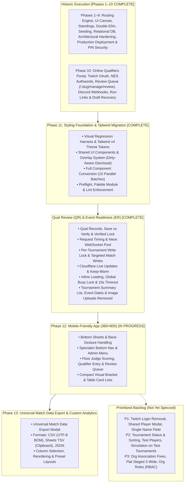

# Master Implementation Plan: Tournament Manager

This document is the single source of truth for MatchFoundry's roadmap: completed phases, out-of-scope capabilities added along the way, upcoming phases, and the deferred backlog. Rules and shipped feature behavior live in the [MatchFoundry Product Spec](MatchFoundry-Product-Spec.md). Anything to build or revisit later belongs here, not in other docs.

---

## 1. Master Roadmap & Global Status (Phases 1–13, Event Readiness, Qual Review)

**Current focus (as of 2026-11-04):** Phase 12, run as three waves of parallel steps. Wave 1, plus 12.1b and 12.2a–c from wave 2, must land before the event. Execution specs are indexed in [`docs/specs/index.html`](specs/index.html).

| Phase | Title | Status | Description |
| :--- | :--- | :--- | :--- |
| **Phase 1** | Core Routing Engine | **Complete** | Mathematical Single-Elimination & Flat routing, bye invariants ($N - 1$ matches). |
| **Phase 2** | Reactive UI & Match Recording | **Complete** | Canvas visualizer, drawer score entry, multi-game tracking, Best-of-X overrides. |
| **Phase 3** | In-Memory Pipeline & Refinements | **Complete** | Mode unification (`isLocked`), global standings, maxout logic, global player catalog. |
| **Phase 4** | Tournament Organizations | **Complete** | Organization directory (`/organizations`), org branding & default rules inheritance, raw metric indexing. |
| **Phase 5** | Double Elimination Bracket Engine | **Complete** | Double elim (Winners, Losers, Grand Finals Reset), Accelerated Hybrid multi-pod layout, player journey search. |
| **Phase 6** | Direct / Manual Seeding & Bulk Import | **Complete** | Qual-less tournament seeding, multiline paste import, drag/drop reordering, tier dividers, direct bracket generation. |
| **Phase 7** | Relational Database & API Backend | **Complete** | PostgreSQL (Neon/Docker) + Drizzle ORM, REST API middleware, authentic player pool (1,620 competitors). |
| **Phase 8** | Architectural Hardening & Tournament Rules | **Complete** | Decoupled domain hooks, canonical defaults, CLI seeder, 415 automated tests, bye seed alternation (1 vs N), points qual 0-pt tiebreaker, OBS draft overlays. |
| **Phase 9** | **Production Cloud Deployment, MatchFoundry™ Brand Launch & CI/CD** | **Complete** | Vercel Serverless runtime (`api/index.ts`), Neon cloud PostgreSQL migration, MatchFoundry™ rebrand & strategic trademark rollout, zero runtime git artifacts, and Branch/PR CI/CD deployment gating. |
| **Phase 10**| **Live & Online Qualifiers Engine** | **Complete** | Competitor self-service portal (`/:slug/qualify`), Twitch OAuth 2.0 on production HTTPS, 6–8 char NES Authwords, qual window telemetry, review queue (`/:slug/manage/review`), Discord webhooks, tokened run links & draft recovery. |
| **Phase 11**| **Styling Foundation & Tailwind Migration** | **Complete** | Tailwind v4 theme tokens and shared UI components, one overlay system with dirty-aware dismissal, every component converted off inline styles, lint-enforced. |
| **QR**| **Qual Review Workflow** | **Complete** | Quals as their own records (`qualifier_runs`), Save vs Verify, Unverify, verified lock, provisional brackets from pending quals. |
| **ER**| **Event Readiness** | **Complete** | Request timing, Neon WebSocket pool and transactions, per-tournament write lock, targeted match writes with conflict detection, Cloudflare live updates, inline loading with a 10 s timeout, a summary-only tournament list, image uploads removed, validated event dates, keep-warm schedule from event dates. Quick fixes, test-tournament hiding, the `cle1` region pin and skip-unchanged full saves shipped. |
| **Phase 12**| **Mobile-Friendly App (360×800)** | **In Progress** | Spectator bottom nav and admin menu, floor judge scoring / qualifier entry / review queue on phones, compact visual bracket, card lists for tables, every route overflow-free. |
| **Phase 13**| **Universal Match Data Export & Custom Analytics** | **Upcoming** | Universal match data export (CSV with UTF-8 BOM, Google Sheets TSV clipboard copy, JSON) with custom column selection and reordering. |

---

## 2. Completed Phases & Historic Execution

### Phase 3: Unified In-Memory Pipeline, Adaptive Qual Board & Operational Polish [COMPLETE]
* **Priority 1: UI Rebranding, Ergonomics, Modal Guards & Mode Terminology:**
  * Rebranded UI to "Tournament Manager" (removed all legacy "CTWC" references).
  * Unified mode terminology: "Qualifiers Mode" (`isLocked === false`) vs "Match Play Mode" (`isLocked === true`).
  * Locked down match cards in `BracketVisualizer`, `OrganizerSheetMatrix`, and `MatchCardFeed` during Qualifiers Mode.
  * Disabled backdrop dismissal on `MatchScoreDrawer`, `PlayerDetailDrawer`, and `QualifierEntryModal`.
  * Added dirty state tracking to `TournamentAdminForm` ("Save Configuration" disabled until dirty) with unsaved changes navigation guard modal.
  * Bound tier colors dynamically (`primaryColor`, `secondaryColor`) to round badges, borders, winner highlights, and trophy icons.
* **Priority 2: Tournament Lifecycle & Simulation Controls:**
  * Replaced legacy `isVerified` and `qualsClosed` with single source of truth `isLocked: boolean`.
  * Enforced unlock safety invariant: blocking unlock if any match has recorded scores.
  * Clean-slate defaults on fresh onboarding (0 tournaments on home switcher; modal routes to `/:slug/manage/settings` with 0 data).
  * Data Management controls in Settings: "Seed Qualifiers Only" (bracket capacity + 4 DNQs), "Simulate Full Tournament" (complete match outcomes to champions), and "Clear All Tournament Data" (guarded by red speedbump confirmation modal). Purged legacy demo pipelines.
* **Priority 3: Global Tournament Standings & Competitive Exit Tiebreakers:**
  * Refactored `standings.ts` to output a unified #1 to #N global list across all tiers.
  * Implemented exact intra-round exit tiebreaker formula (exit game wins $\rightarrow$ loss avg $\rightarrow$ match record $\rightarrow$ game avg $\rightarrow$ seed).
  * Continuous `FinalStandingsTable.tsx` with overview stat cards, performance analytics columns, and Qual vs. Final rank delta badges.
* **Priority 4: Qualifiers Table Density & Competitor Detail Drawer:**
  * Implemented Maxout count ($\ge 999,999$) + kicker score sorting hierarchy in `scoring.ts`.
  * Format-dense column rendering on `LeaderboardTable.tsx` adapting to `HIGH_SCORE`, `AVERAGE_OF_X`, and `POINTS`.
  * Slide-out `PlayerDetailDrawer.tsx` displaying competitor profile, chronological qualifier submission audit log, and match breakdown.
* **Priority 5: Global Player Pool Directory & Tournament Roster:**
  * Master player directory under LocalStorage key `classic_tetris_global_players` at `/players`.
  * "Generate Fake Players" prompt modal with presets (`+8`, `+16`, `+32`, `+64`) generating realistic competitors.
  * Tournament roster registration with "Import from Global Pool" and "Import All Available" actions.
* **Priority 6: Accelerated Hybrid Layout, Player Journey Highlighting & Operational Polish:**
  * Accelerated Hybrid multi-pod layout: side-by-side Fit/Split views, scrollbar elimination in Pod 2, Pod 3 match centering, and responsive single-column collapse.
  * Competitor search input in `BracketTierBar` with auto-complete and zero-lag Player Journey SVG path illumination.
  * Double Elimination judge feed filtering: resolved stage filter desynchronization, unique round keys, and tier-switching remounting hygiene (`key={tier.id}`).
  * Established permanent automated regression test mandate in `AGENTS.md`.

---

### Phase 6: Direct / Manual Seeding & Roster Seeding Engine [COMPLETE]
* **Objective:** Enable tournament organizers to seed tournaments directly without requiring qualifier submissions, supporting invitationals, pre-ranked community events, and blind-draw tournaments.
* **Delivered Capabilities:**
  * **Seeding Mode Toggle:** Introduced `seedingMethod: 'QUALIFIERS' | 'MANUAL'` on `Tournament` with settings toggle in `TournamentAdminForm`. Qual-specific fields cleanly collapse when in manual mode.
  * **Bulk Seed Import (`BulkSeedImportModal.tsx`):** Large multiline paste modal. Parser strips bullets, numbering (`1. `, `#1 `, `- `), trims whitespace, and automatically resolves names against tournament rosters and the global player catalog.
  * **Interactive Seeding Manager (`ManualSeedingManager.tsx`):** Dedicated management view with drag-and-drop handles, Move Up/Down/Top/Bottom buttons, direct seed number assignment, reverse order, and Fisher-Yates random shuffle (with confirmation speedbump).
  * **Dynamic Tier Boundary Dividers:** Visual tier cutoff banners (Gold Tier, Silver Tier, Reserves/Alternate pool) rendered directly across the manual seed list.
  * **Bracket Generator Hook:** `generateDraftBracketsForTournament` directly bypasses `deriveLeaderboard` when in manual mode and distributes `manualSeeds` across tier capacities.
  * **Standings & Simulation Integration:** Computes `rankDelta` relative to assigned manual seeds; adapts simulation controls to generate realistic manual seedings.
  * **Automated Regression Suite:** 10 comprehensive tests in `src/features/tournament/__tests__/manualSeeding.test.ts`.

---

### Phase 7: Relational Database & Server API Backend [COMPLETE (FOUNDATION)]
* **Objective:** Transition `tournament-manager` from ephemeral client-side LocalStorage to a persistent relational database with server API routes.
* **Delivered Capabilities:**
  * **PostgreSQL Schema (`src/db/schema.ts`):** Complete relational models with foreign key constraints, cascading deletes, and indexes:
    * `organizations`: Organization identity, branding, theme colors, tier themes, default rules.
    * `players`: Competitor identity with `lower(trim(name))` uniqueness index, country, playstyle, PB, notes.
    * `tournaments`: Tournament identity, organization FK, qual format, points config, `is_locked`, metadata.
    * `bracket_tiers`: Tier configuration, tournament FK, priority order, bracket type, colors, metadata.
    * `tournament_players`: Roster assignments, player FK, tier FK, seed, qual completion status.
    * `qualifier_submissions`: Scores, timestamps, player FK, tournament FK.
    * `matches` & `games`: Relational match play tracking, game scores, Best-of-X, forfeit flags, winner/loser FKs.
  * **Database Infrastructure:** Docker compose environment (`docker-compose.yml`) running PostgreSQL 16 on port 5433, with Drizzle Kit push migrations (`npm run db:push`) and Drizzle Studio (`npm run db:studio`).
  * **Server API Middleware (`src/server/api.ts`):** Vite dev server API middleware supporting:
    * `/api/organizations`: Org CRUD, detail lookup by ID/slug, default rules sync.
    * `/api/tournaments`: Full tournament creation, retrieval, updates, and deletion.
    * `/api/players`: Player CRUD, directory lookups, search.
    * `/api/tournaments/:id/qualifiers`: Atomic score submission and batch qualifiers ingestion.
    * `/api/tournaments/:id/matches`: Match score recording and resets.
    * `/api/simulate/sample`: 1-click sample tournament generation.

---

### Out-of-Scope Capabilities Delivered Along the Way [COMPLETE]
* **1,620 Authentic Competitor Seed Dataset (`scripts/importPlayers.ts`):**
  Imported 1,620 real-world competitive Classic Tetris competitors with authentic names, randomized realistic countries, playstyles (Rolling, DAS, Hypertap), and personal bests (750k–1.4M) into PostgreSQL.
* **Cross-Platform CLI Compatibility:**
  Hardened database scripts, `drizzle.config.ts`, and Node execution hooks for seamless Windows PowerShell and POSIX execution.
* **Drizzle Studio Navigation Architecture:**
  Integrated schema relationships enabling Drizzle Studio's virtual navigation badges between parents and children (`bracket_tier`, `games`, `tournament`).

### Phase 8: Architectural Hardening, Domain Decoupling & Tournament Rules [COMPLETE]
* **Objective:** Eliminate monolithic state bottlenecks, decouple domain hooks, establish canonical entity factories, introduce fast test suites, and resolve all mathematical and lifecycle edge cases across 415 passing automated regression tests.
* **Delivered Capabilities:**
  * **Domain Hooks Decoupling:** Created independent domain hooks in `src/features/tournament/hooks/` (`useTournamentSettings`, `useQualifiers`, `useMatches`, `useGlobalPlayers`) with index re-exports and backward-compatible bindings in `store.tsx`.
  * **Single Entity Factory & Defaults (`src/features/tournament/defaults.ts`):** Canonical factories `createEmptyTournament()`, `createDefaultTier(priority)`, and `createEmptyPlayer()` implemented and adopted in `TournamentAdminForm.tsx` and `CreateTournamentModal.tsx`.
  * **Dedicated CLI Database Seed Script (`npm run db:seed`):** Standalone cross-platform script `scripts/seed.ts` seeding default organizations, 1,620 authentic competitors, and sample tournaments directly via Drizzle into PostgreSQL.
  * **Contract Alignment & Strict Type Invariants:** Eliminates loose `Record<string, any>` types with strict `TournamentMetadata`, `TierMetadata`, `OrganizationBranding`, and `OrganizationDefaultRules` in `types.ts` and `schema.ts`. Hardens `TierInput` and `TierRecord` to defensively support both `playerCount` and `numPlayers` and align `BracketRouting` with `TRADITIONAL_TREE`.
  * **Targeted Fast-Feedback NPM Test Scripts:** Added `npm run test:brackets` (~2.6s), `npm run test:api` (~5.5s), and `npm run test:ui` (~3.1s) to `package.json`.
  * **Agent Architecture Index:** Added Domain File Map and updated verification commands in `AGENTS.md`.
  * **Flat Bracket Bye Seed Alternation (1 vs N):** Updated `seed-utils.ts`, `flat.ts`, and `double-elimination.ts` so byes follow standard competitive tournament bracket alternation: highest seeds receive byes and face the lowest surviving seeds ($1 \text{ vs } N, 2 \text{ vs } N-1$), ensuring Seeds 1 and 2 only meet in the Finals.
  * **Points Qualifier Tiebreaker for 0-Point Players:** Updated `scoring.ts` to compute each player's highest single game score (`peakScore`) and sort descending as the primary tiebreaker for players with 0 points (and tied point totals).
  * **Simulation & Data Management Safety Hierarchy:** In `DataSimulationSection.tsx` and `TournamentAdminForm.tsx`, disabled and blocked "Clear Quals" whenever active match scores exist. Enforced the strict lifecycle hierarchy: "Clear Matches" must be executed before "Clear Quals" becomes enabled.
  * **Settings 'Add Tier' Button Placement:** Positioned the "+ Add Tier" button at the bottom of the tiers list when 1 or more tiers exist (retaining it prominently in the empty state when 0 tiers exist).
  * **Homepage Tournament Card Navigation to Admin Bracket View:** Routed homepage card "Brackets" action button and tier pill links directly to the admin management bracket view (`/:slug/manage/bracket/${tier.slug}`).
  * **Global Player Card Identity:** Extended `PlayerProfile`, database schema `players` table, API layer, `PlayerEditModal.tsx`, `PlayerDetailDrawer.tsx`, and `PlayerDirectory.tsx` with `displayName`, `nickname`, and `twitchUsername` (sanitizing `@` prefix and providing Twitch stream badges).
  * **Pre-Lock Bracket Visibility in OBS Overlays:** Created `ObsBracketView.tsx`, `ObsMatchCardView.tsx`, and `ObsOverlayPage.tsx` supporting draft bracket preview mode when `tournament.isLocked === false` with chroma key support (`?chroma=green|#hex`), generating draft/projected match nodes with live qualifier seeds or placeholder seeds and displaying a pulsing "DRAFT PREVIEW" header badge.
  * **Automated Regression Suite:** 12 tests in `src/features/tournament/__tests__/domainHooksAndDefaults.test.ts` and 7 tests in `src/features/tournament/__tests__/tournamentRulesAndLifecycleRegression.test.ts`.

---

## 3. Prioritized Implementation Roadmap (Remaining Work)

---

### Phase 9: Production Cloud Deployment, MatchFoundry™ Brand Launch & CI/CD [COMPLETE]
* **Goal:** Deliver a fully deployed, production-grade tournament management platform on the public web (`matchfoundry.gg` on Vercel + Neon PostgreSQL), fortified by multi-tier PIN access security, a strategic MatchFoundry™ rebrand with common-law trademark protections, and a gated Branch/PR CI/CD delivery pipeline.

* **Track 9A: Multi-Tier PIN Security Engine [COMPLETE]**
  1. **Security Hierarchy:**
     * **Level 0 (Public / Spectator):** Frictionless read-only access to public views (`/:slug/brackets`, `/:slug/quals`, `/:slug/standings`, `/:slug/qualify`, OBS overlays). Protected routes redirect to PIN login.
     * **Level 1 (Tournament Admin):** Scoped by per-tournament PIN (`admin_pin_encrypted`). Unlocks management left-nav (`/:slug/manage/*`). Unauthorized navigation to global admin views bounces to admin login.
     * **Level 2 (Master / System Admin):** Authenticated via Master PIN or immutable environment fallback `SYSTEM_ADMIN_RECOVERY_PIN`. Grants global access across all tournaments, organizations, and player catalogs.
  2. **Data Management & Simulation Isolation:**
     * Destructive simulation controls ("Clear All Tournament Data", "Simulate Full Tournament", "Seed Qualifiers Only") and bulk endpoints (`/api/simulate/sample`) are strictly hidden and restricted to System Admins. Tournament Admins cannot view or trigger data wipe operations.
  3. **AES-256-GCM Two-Way Encryption (`pinCrypto.ts`):**
     * Encrypts tournament PINs at rest using secret `PIN_ENCRYPTION_KEY`, allowing System Admins to safely reveal PINs (`👁️ 7492`) without invalidating active sessions.
  4. **Signed Session Tokens & API Route Guards:**
     * Signed 7-day tokens verified by `createApiMiddleware()` on all mutation methods (`POST`, `PUT`, `DELETE`).

* **Track 9B: Production Cloud Infrastructure & Serverless Bundler [COMPLETE]**
  1. **Neon Serverless PostgreSQL:** Provisioned and migrated schema across all 9 relational tables; connected via `@neondatabase/serverless` connectionless HTTP driver (`drizzle-orm/neon-http`).
  2. **Standalone Serverless Bundler Pipeline:** Transitioned serverless API entry point from temporary build bundle to pure TypeScript `api/index.ts` transpiled on the fly by `@vercel/node`.
  3. **Vercel SPA & API Routing:** Configured `vercel.json` rewrites routing `/api/(.*)` to the serverless function and all other routes to `dist/index.html` with `x-matched-path` header normalization.
  4. **Custom Domain & DNS:** Live on custom domain `https://www.matchfoundry.gg` via Cloudflare DNS and Vercel Edge Network.

* **Track 9C: MatchFoundry™ Brand Identity & Trademark Rollout [COMPLETE]**
  1. **Strategic Trademark (`™`) Placement:**
     * Assert common-law trademark rights on primary anchors without cluttering body text:
       * Primary header logo: `MATCH` + gold `FOUNDRY` + superscript `™` in `TopNavSwitcher.tsx` and `TournamentSidebar.tsx`.
       * Page title: `<title>MatchFoundry™ | Tournament Command Center</title>` in `index.html`.
       * Hero & login subtitle: `MatchFoundry™ Access Control` in `AdminLoginPage.tsx` and `TournamentSwitcherPage.tsx`.
       * Subtle footer/legal line: `© 2026 MatchFoundry™. All rights reserved.` in `TournamentSwitcherPage.tsx` and `AdminLoginPage.tsx`.
  2. **Package & Metadata Unification:**
     * Updated `package.json` and `package-lock.json` name from `tournament-manager` to `matchfoundry`.
     * Updated Discord webhook test dispatches in `OrganizationDashboard.tsx`.
     * Added automated brand verification test suite in `src/components/__tests__/rebrand.test.tsx`.

* **Track 9D: Gated Branch/PR CI/CD Pipeline & Zero-Artifact Git Hygiene [COMPLETE]**
  1. **Zero Built Artifacts in Git & Dynamic Serverless Bundler:**
     * Purged the temporary compiled bundle `api/index.js` from git tracking.
     * Added `api/*.js` to `.gitignore` so runtime build artifacts can never be committed.
     * Maintained `src/server/serverless.ts` as pure TypeScript source code.
     * Wired `build:api` into `npm run build` (`"build": "tsc --noEmit && vite build && npm run build:api"`), bundling `src/server/serverless.ts` on-the-fly into `api/index.js` during both CI and Vercel cloud deployments without dirtying Git.
  2. **Trunk-Based PR Workflow:**
     * Dedicated feature branch: `feature/matchfoundry-rebrand-and-cicd` $\rightarrow$ Pull Request to `main`.
     * Automated GitHub Actions CI workflow triggered on PR:
       * `npm run typecheck`
       * `npm test` (full Vitest suite: 43 test files, 494 passing tests)
       * `npm run build` (pure client bundle verification)
     * Vercel automated preview deployments for live browser verification before merge.
  3. **Production Deployment Gate:**
     * Vercel production deployment triggers strictly upon merging PR into `main` after all CI status checks pass.
     * Prevents untested or breaking changes from ever landing on production `main`.
  4. **Local/Cloud Isolation Verification:**
     * Local development remains cleanly bound to Docker PostgreSQL (port 5432) with git-ignored `.env`, while Vercel production connects exclusively to Neon via dashboard secrets.
     * Golden journeys smoke tests passing cleanly in Playwright (`npm run test:e2e`).

---

### Phase 10: Live & Online Qualifiers Engine [COMPLETE]
* **Status:** Shipped across PRs #5–#8.
* **Beyond the original plan (PR #8, online run recovery):**
  * Starting a run issues a private run token and link. The competitor is added to the roster only on submit, not on start.
  * Drafts autosave by token and can be restored by run link, or by name + Twitch account.
  * Competitors can discard an unfinished run (walk-in players are removed with it). Submitted runs cannot be discarded.
  * Unfinished runs are hidden from the leaderboard and don't block roster removal or player deletion. Runs more than an hour past their window are flagged as abandoned.
  * Tokens and drafts are never exposed in public data.
  * Coverage: `src/features/online-quals/__tests__/runLinksAndCleanup.test.ts`.
* **Goal:** Deliver the full online self-service competitor qualification portal, running directly against the deployed production HTTPS environment (`matchfoundry.gg` on Vercel + Neon PostgreSQL), complete with robust identity resolution, Twitch OAuth 2.0, NES Authwords, and mixed-mode adjudication.

* **Track 10A: Relational Database Schema & Data Models (`src/db/schema.ts`, `src/features/tournament/types.ts`)**
  1. **Player Identity Extensions (`players` table):**
     * `twitch_id`: `text` (unique index, nullable) — Permanent, immutable Twitch account ID.
  2. **Qualifier Submissions Overhaul (`qualifier_submissions` table):**
     * `submission_source`: `text` enum (`'IN_PERSON'`, `'ONLINE'`, default `'IN_PERSON'`).
     * `auth_word`: `text` (nullable) — Assigned 6–8 character NES verification word.
     * `twitch_vod_url`: `text` (nullable) — Deep-link to competitor's stream broadcast.
     * `submitted_twitch_id`: `text` (nullable) — Immutable audit record of the authenticated Twitch account.
     * `submitted_twitch_username`: `text` (nullable) — Snapshot of Twitch handle at submission time.
     * `identity_status`: `text` enum (`'VERIFIED_MATCH'`, `'CLAIMED_PENDING_REVIEW'`, `'PROVISIONAL_NEW'`).
     * `status`: `text` enum (`'NOT_STARTED'`, `'IN_PROGRESS'`, `'SUBMITTED'`, `'VERIFIED'`, `'DNQ'`, `'DQ'`).
     * `timer_log`: `jsonb` (`QualTimerLog`: `startedAt`, `submittedAt`, `elapsedSeconds`, `pauses`).
     * `judge_notes`: `text` (nullable) — Adjudicator audit comments and timestamps.
     * `verified_by`: `text` (nullable) — Judge user identifier.
     * `verified_at`: `timestamp` (nullable).
  3. **Tournament Mixed-Mode Config (`tournaments` table):**
     * `qual_mode`: `text` enum (`'IN_PERSON'`, `'ONLINE'`, `'HYBRID'`, default `'HYBRID'`).
     * `qual_window_minutes`: `integer` (default 90).
     * `custom_auth_words`: `jsonb` (`string[]`).

* **Track 10B: Twitch OAuth 2.0 Integration & Identity Resolution Engine**
  1. **OAuth 2.0 Production Handshake:**
     * Dedicated endpoints: `/api/auth/twitch/authorize` and `/api/auth/twitch/callback` with PKCE / state CSRF validation.
     * Local dev fallback mock authentication for isolated Vitest/development without live Twitch credentials.
  2. **3-Tier Identity Resolution Protocol:**
     * **Tier 1 (Verified Repeat Competitor):** `players.twitch_id = session.twitch_id` $\rightarrow$ 100% confidence, auto-linked as `VERIFIED_MATCH`.
     * **Tier 2 (Roster Claim):** Unlinked competitor claims an existing tournament roster profile $\rightarrow$ `CLAIMED_PENDING_REVIEW` (unblocks competitor run immediately, requires judge ratification).
     * **Tier 3 (Provisional New Player):** Walk-in competitor registers new competitive alias, country, and playstyle $\rightarrow$ `PROVISIONAL_NEW`.

* **Track 10C: NES Authword Generator & Telemetry Engine**
  1. **NES Character Set Enforcer:**
     * Strict validation against NES Tetris high-score charset: `A–Z`, `0–9`, `.`, `-`, `!`, `♥` (length: 6–8 chars; spaces strictly forbidden).
  2. **Curated Dictionary Engine:**
     * Curated dictionary of ~1,000 family-friendly English words ($\ge 6$ letters).
     * Seamlessly merges tournament-specific `custom_auth_words`.
  3. **Non-Blocking Telemetry Countdown Timer:**
     * React countdown timer inheriting `qualWindowMinutes`.
     * Non-blocking architecture: expiry logs over-time telemetry without disabling submit button.
     * Captures `QualTimerLog` telemetry (`startedAt`, `submittedAt`, `elapsedSeconds`, `pauses`).

* **Track 10D: Competitor Self-Service Portal (`/:slug/qualify`)**
  1. **3-Tier Component Architecture:**
     * Tier 1: Route Gate (`src/routes/PublicQualifyPage.tsx`).
     * Tier 2: Keyed Feature View (`src/features/online-quals/components/CompetitorPortalView.tsx`).
     * Tier 3: Pre-flight briefing modal, active session HUD, Authword display, submission form.
  2. **Session Lifecycle:**
     * Pre-flight checklist confirming live broadcast and Twitch past broadcast storage.
     * Session launch, active Authword HUD, game score entry, VOD URL paste.
     * "I'm Done" confirmation card with instant provisional leaderboard placement (`[⏳ Awaiting Verification]`).

* **Track 10E: Mixed-Mode Adjudication & Identity Resolution Queue (`/:slug/manage/review`)**
  1. **Dedicated Review Queue Interface:**
     * Accessible via `/:slug/manage/review` with pending submission counter badge in navigation sidebar.
  2. **Identity Resolution & Override Actions:**
     * **"Confirm Identity Binding":** Permanently writes `twitch_id` to the claimed player's global profile.
     * **"Reassign / Link to Different Player":** Roster and global catalog search to correct mistaken claims.
     * **"Promote to Global Player":** Instantly creates a canonical row in `players`, imports to tournament roster, and verifies qualification.
  3. **Submission Adjudication:**
     * Twitch VOD link for verifying the Authword on the 10k topout screen.
     * Timer log elapsed time validation.
     * Action buttons: "Verify Qual", "Edit Score & Verify", "Mark DNQ", "Disqualify (DQ)".

* **Track 10F: Discord Webhook Dispatches & Mixed-Mode Leaderboard Polish**
  1. **Automated Discord Webhooks:**
     * Qual Start: `"🎮 [Player] started an official qual for [Tournament]! Watch live: [Twitch URL]"`
     * Qual Submit: `"🏆 [Player] submitted qual: [Score] avg. VOD: [Twitch VOD URL]"`
     * Qual Verified: `"✓ [Player]'s qualification has been verified by judge: [Score]"`
  2. **Unified Leaderboard Enhancements (`LeaderboardTable.tsx`):**
     * Multi-source pills: `[All]`, `[🏢 In-Person]`, `[🌐 Online]`, `[⏳ Pending Review]`.
     * Source indicator badges and clickable VOD icons for remote runs.

* **Track 10G: Automated TDD Regression Suite & User Journey Assertions**
  * **TDD Invariant & Definition of Done:** Development follows strict Acceptance-Test-Driven Development (ATDD). High-level journey assertions are codified in automated tests before component implementation; a track is complete only when its corresponding journey tests pass with zero regressions.
  
  1. **Journey 1 Assertions: The Online Competitor Portal (`src/features/online-quals/__tests__/competitorJourney.test.tsx`):**
     * *Assertion 1.1 (OAuth Gate):* Unauthenticated navigation to `/:slug/qualify` displays the Twitch Connect action; valid OAuth session resolves handle, avatar, and channel link.
     * *Assertion 1.2 (Identity Disambiguation):* Unmatched Twitch accounts present the dual choice modal (claim pre-registered tournament profile vs. register new alias); selecting either does not block starting the run.
     * *Assertion 1.3 (Authword Generation & Charset):* Initiating run generates an immutable 6–8 char Authword matching regex `/^[A-Z0-9.\-!♥]{6,8}$/` (no spaces).
     * *Assertion 1.4 (Timer Telemetry):* Non-blocking countdown initiates at `qualWindowMinutes`; expiring timer keeps submit active while recording over-time telemetry.
     * *Assertion 1.5 (Persistence):* Page reloads or tab closures during an active run cleanly recover active Authword and remaining elapsed time without resetting session.
     * *Assertion 1.6 (Submission Lockout & Provisional Impact):* Submitting valid scores + Twitch VOD link locks inputs to read-only, generates a confirmed receipt card, and immediately places the competitor on `/:slug/leaderboard` with status `[⏳ Awaiting Verification]`.

  2. **Journey 2 Assertions: Mixed-Mode Adjudication & Ingestion (`src/features/online-quals/__tests__/mixedModeAdjudication.test.tsx`):**
     * *Assertion 2.1 (Ingestion Source Separation):* Scores recorded via `QualifierEntryModal` save with `submission_source = 'IN_PERSON'`, `is_verified = true`, `status = 'VERIFIED'`; portal scores save with `submission_source = 'ONLINE'`, `is_verified = false`, `status = 'SUBMITTED'`.
     * *Assertion 2.2 (Review Queue Badge):* Tournament sidebar dynamically reflects the exact count of pending online submissions (`Review Queue (N)`).
     * *Assertion 2.3 (Adjudication Actions):*
       * Clicking *"Verify Qual"* flips status to `VERIFIED`, decrements queue badge, and changes leaderboard status to `✓ Verified`.
       * Clicking *"Edit Score & Verify"* mutates the recorded score, writes an audit log to `judge_notes`, and verifies.
       * Clicking *"Mark DNQ"* marks `status = 'DNQ'`, retains audit record, and excludes player from bracket seed calculation.
       * Clicking *"Disqualify (DQ)"* sets `is_disqualified = true` on the player profile.

  3. **Journey 3 Assertions: Identity Binding & Overrides (`src/features/online-quals/__tests__/identityResolution.test.tsx`):**
     * *Assertion 3.1 (Confirm Binding):* Confirming a `CLAIMED_PENDING_REVIEW` submission permanently writes `players.twitch_id = session.twitch_id`. Subsequent logins with that Twitch ID auto-resolve as `VERIFIED_MATCH`.
     * *Assertion 3.2 (Judge Reassign):* Reassigning a submission from Player A to Player B updates `qualifier_submissions.player_id` and shifts leaderboard scores accordingly.
     * *Assertion 3.3 (Promote Provisional New Player):* Confirming a `PROVISIONAL_NEW` competitor inserts a permanent row into `players`, creates `tournament_players` registration, and attaches the submission.

  4. **Journey 4 Assertions: Qualifiers Cutoff & Bracket Locking (`src/features/tournament/__tests__/qualsCutoffLifecycle.test.tsx`):**
     * *Assertion 4.1 (Gated Closure):* Attempting to close qualifiers while unverified submissions remain triggers a blocking confirmation alert.
     * *Assertion 4.2 (Locked Public Portal):* Setting `quals_closed = true` disables run initiation on `/:slug/qualify` and shows a "Qualifying Closed" announcement.
     * *Assertion 4.3 (Draft Bracket Seeding Integrity):* Auto-seeded bracket draft includes all verified players and strictly excludes players marked `DNQ` or `AWAITING_VERIFICATION`.

  5. **Golden Journey (Playwright E2E — Journey 5 in `e2e/golden-journeys.spec.ts`):**
     * End-to-end browser walkthrough: Remote competitor lands on `/omen-ao3/qualify` $\rightarrow$ checks in with name and Twitch handle $\rightarrow$ completes pre-flight checklist $\rightarrow$ receives Authword $\rightarrow$ submits scores + VOD link $\rightarrow$ verifies provisional leaderboard appearance $\rightarrow$ logs in as Tournament Admin $\rightarrow$ opens Review Queue $\rightarrow$ clicks "Verify Qual" $\rightarrow$ confirms public leaderboard updates to official verified standing.

---

### Phase 11: Styling Foundation & Tailwind Migration [COMPLETE]
* **Goal:** Every component styled with Tailwind v4 classes and shared UI components instead of inline styles (about 3,000 sites today), with no visual change beyond token snapping, and one overlay system that applies the dismissal rule everywhere.
* **Dismissal rule:** read-only overlays and confirmations close on backdrop click/tap and Escape; forms with unsaved changes show "Discard unsaved changes?" (Keep Editing / Discard Changes).
* **Steps:** 11.0 foundation (visual regression harness, Tailwind, tokens, `src/components/ui`); 11.1 overlay system (37 overlays); 11.2 conversion in 10 batches across two parallel waves; 11.3 cleanup (preflight, palette module, lint enforcement).

---

### Qual Review Workflow (QR) [COMPLETE]
* **Goal:** a qual is its own record that survives having zero scores; saving and verifying are separate; verified quals are locked until unverified; pending quals seed provisional brackets.
* **QR.1 Qual records:** new `qualifier_runs` table with a lazy backfill (`attachOrphanScoresToRuns`); every qual API reads and writes the run; zero-score quals persist.
* **QR.2 Review workflow:** Save vs Verify, Unverify, verified lock, submitted date and time, provisional brackets from pending quals, a lock warning, pending simulated quals, and walk-in wording removed.

---

### Event Readiness (ER) [COMPLETE]
* **Goal:** before the event, writes take well under a second, two judges saving at once never lose each other's work, page loads fetch only what the page shows, every open page updates without a refresh, and every action shows inline loading with a timeout.
* **Why:** most writes took 2–3 s (one HTTPS round trip per query on the `neon-http` driver, plus cold starts). Every match write re-saved the whole tournament (delete and re-insert all matches and games), so concurrent judges overwrote each other, and a settings save could undo scores on a locked tournament. Pages only refreshed on navigation or window focus.
* **Steps:**
  1. **ER.1** Request timing: `Server-Timing` header and `[api]` log lines with duration and query count.
  2. **ER.2** Driver and transactions: Neon WebSocket pool, real transactions, parallel tournament loads, real-Postgres test tier (`npm run test:pg`).
  3. **ER.3** Tournament write lock: row lock and revision on every tournament write; a locked tournament's settings save no longer touches scores or brackets.
  4. **ER.4** Targeted match writes: score, forfeit and best-of write only their own rows; per-match revision returns 409 `MATCH_CONFLICT`; the score drawer never wipes a judge's typing on refresh.
  5. **ER.5** Realtime worker: Cloudflare Worker with one Durable Object per tournament (free tier), plus an event-day keep-warm cron.
  6. **ER.6** Live updates: the API publishes after each write; open pages refresh themselves; anonymous refreshes are CDN-cached per revision; the qual timer uses the server clock.
  7. **ER.7** Loading foundation: spinner, `useAction`, global busy lock, 10 s timeout, shared error banner.
  8. **ER.8** Loading flows: judge, qualifier, review-queue and admin actions converted.
  9. **ER.9** Tournament summaries: `GET /api/tournaments` returns small summaries in a fixed 5 queries instead of every tournament in full (about 8 queries and 85 KB per tournament, on every page load for every visitor). Each page loads only its own tournament; the organization dashboard gets its own endpoint for metrics.
  10. **ER.10** Hide image uploads: remove the player avatar upload, organization logo and banner fields, and tournament logo and banner fields. Images are stored as base64 in the database and the feature is unused; saved images keep displaying. The proper fix is backlog item 15.
  11. **ER.11** Event dates: the free-text event date (stored values include `Upcoming` and `Yah`) becomes a validated `startDate` and optional `endDate`, stored in two new `date` columns, entered with date pickers and shown as "Nov 14–16, 2026". Old free-text dates were not converted; real dates are set in Settings.
  12. **ER.12** Keep-warm schedule: the worker's keep-warm cron fetches event-day windows from `GET /api/keep-warm-schedule` once a day and stores them in a Durable Object, replacing the hand-edited `KEEP_WARM_FROM`/`KEEP_WARM_UNTIL`.
* **Shipped:** PRs #20–#26. The realtime worker is deployed at `matchfoundry-realtime.matchfoundry.workers.dev` (one worker for all environments, deployed by hand with `npm run realtime:deploy`; deploying it from CI is backlog item 16).
* **Decisions:** live updates use push (Cloudflare Durable Objects), not polling; messages carry only a revision and clients re-fetch through the API. Loading is inline on the clicked button, every other button is disabled, and a 10 s timeout shows an error banner.
* **Write performance (measured 2026-11-02 on Vercel previews):** read from the `Server-Timing` header added in ER.1. Same test tournament at every stage: 32 players, Gold (16, traditional, 15 matches) and Silver (16, flat, 8 matches), locked. Warm = 3 consecutive runs; cold = first request after 10 idle minutes. Each cell is server time / query count.
  * **Before ER.2:** commit `2304566`, `neon-http` driver, functions in `iad1`.
  * **After ER.4:** commit `23d26d3`, WebSocket pool, write lock, targeted match writes, functions still in `iad1`.
  * **After region and skip fixes:** commit `7d8d769`, functions pinned to `cle1` beside Neon (`us-east-2`), and `saveFullTournament` skips UPDATEs for unchanged players and qual scores.

  | Action | Before ER.2 | After ER.4 | After region and skip fixes |
  | :--- | :--- | :--- | :--- |
  | Save a match score | 1,393–1,725 ms / 94 | 451–481 ms / 26 | **81–118 ms / 26** |
  | Save tournament settings | 1,261–1,339 ms / 86 | 1,520–1,584 ms / 92 | **125–138 ms / 28** |
  | Start the qual timer | 1,260–1,281 ms / 86 | 1,582–1,595 ms / 92 | **121–137 ms / 28** |
  | Delete a global player (not in any tournament) | 73–140 ms / 5 | 82–84 ms / 5 | **23–25 ms / 5** |
  | Save a match score, **cold** (server / total round trip) | 2,470 ms / 4.4 s | 1,136 ms / 2.8 s | **862 ms / 2.7 s** |

  * **ER.4** cut a score save from 94 queries (re-saving the whole tournament) to 26. Settings and timer saves got slightly slower: ER.3's lock and pre-load added queries, and skipping the match rewrite saved little because matches were already batch-inserted.
  * **Region:** functions ran in `iad1` (Washington DC) against Neon in `us-east-2` (Ohio), so every query cost about 15–17 ms. In `cle1` a query costs about 3–4 ms.
  * **Skip unchanged rows:** a full save sent one sequential UPDATE per player and per qual score (about 64 here). It now sends only the ones that changed.
  * **Cold starts remain the largest cost:** about 2.5 s, mostly Vercel booting the function before the handler runs. ER.5's keep-warm cron targets this on event days.
  * Network and Vercel overhead outside the handler is about 100–200 ms when warm.
  * **Reads:** `GET /api/tournaments` loads every tournament in full on every page load, for every visitor (preview: 4 tournaments, 33 queries, 338 KB). ER.9 replaces it with summaries.
* **Already shipped with this phase (quick fixes):**
  * MAXOUT chips and callouts removed everywhere; the "# of maxes" count stays (qual score and kicker contexts).
  * Standings subtitles ("16 Bracket Competitors • Best of 5") removed; "competitors" now reads "players".
  * Double-elim drop match-number tag stays highlighted instead of lighting only briefly.
  * Identity → add global player offers Hybrid (shared `src/features/players/playstyleOptions.ts`).
  * Tournament `isTest` flag (`metadata.isTest`): Mark/Unmark as Test in settings, Test badge on cards, test tournaments hidden from the front page, admin "Show test tournaments" toggle.

---

### Phase 12: Mobile-Friendly App (360×800) [IN PROGRESS]
* **Goal:** every route usable on a 360×800 phone with no page-level horizontal scroll, 44px tap targets and 16px inputs. OBS overlay routes are out of scope; the OBS hub is in scope.
* **Priority order:** (1) spectator navigation from the landing page (bottom tab bar, tier chip strip, landing grid) and admin navigation (top bar, plus a bottom bar with Judge, Quals, Review and Bracket shortcuts and a Menu sheet); (2) floor judge tools: score sheet, qualifier entry, review queue and adjudication; (3) compact visual bracket (seed, name, match wins, keeping the bracket shape); (4) card lists for standings, roster and the player directory; (5) every remaining page.
* **Execution:** three waves; every step in a wave owns a disjoint set of files, so a wave's steps run as parallel agents. Each wave ends with a coordinator gate (typecheck, full tests, overflow test, screenshot review and re-baselining with approval, manual check at 360×800). Specs: [`docs/specs/index.html`](specs/index.html).
  * **Wave 1 (4 parallel):** 12.0a overlays and touch sizing (bottom sheets, Back closes overlays); 12.0b mobile test harness (`npm run test:overflow`, one row per route tagged with its owning step); 12.1a spectator shell; 12.1c landing page and page header.
  * **Wave 2 (14 parallel):** 12.1b admin shell; 12.2a match scoring; 12.2b qualifiers; 12.2c review queue; 12.3 compact bracket; 12.4a final standings; 12.4b roster; 12.4c player directory; 12.5a settings; 12.5b seeding; 12.5c organizer sheet; 12.5d organizations; 12.5e OBS hub and login; 12.5f competitor portal.
  * **Wave 3:** 12.6 sign-off (new mobile screenshots, full overflow run, docs).
* **Before the event:** all of wave 1, then 12.1b and 12.2a–c from wave 2.
* **Interaction with the backlog:** `IdentityClaimModal.tsx` is no longer rendered anywhere; Phase 12 leaves it alone and backlog item 1 deletes it.

---

### Phase 13: Universal Match Data Export & Custom Analytics [UPCOMING]
* **Goal:** Finalize export pipelines and reporting tools.
1. **Universal Match Data Export Modal** (in Tournament Management):
   * **Column toggles:** Tournament Name, Tier Name, Stage (Winners / Losers / Grand Finals), Round Identifier / Number, Match ID, Player 1 Name / Seed / Match Wins, Player 2 Name / Seed / Match Wins, Winner Name, Loser Name, Game-by-Game Scores (e.g. `Game 1: 520k - 480k, Game 2: ...`), Forfeit Status, Intentional Topouts.
   * **Column reordering:** drag-and-drop or up/down, to match existing community spreadsheet layouts.
   * **Presets:** "CTWC Match Sheet", "Detailed Audit", "Simple Bracket Results".
2. **Formats:**
   * **CSV:** UTF-8 BOM encoding so Excel opens it correctly.
   * **TSV / Copy to Clipboard:** tab-separated text for direct `Ctrl+V` into Google Sheets.
   * **JSON:** full raw tournament dump for external tools and archives.
* **Current state:** Not started.

---

### Prioritized Backlog
Agreed or recorded work that has no execution spec yet. Items are in rough priority order; each needs a step spec (in `docs/specs/`, linked from [`docs/specs/index.html`](specs/index.html)) before it is executed. Items 1–10 come from the 2026-11-02 event-readiness review; their decisions are already made. Phase 13 (export) has not been ranked against these; decide when Phase 12 finishes.

#### Priority 1: Players and competitor flow (right after Phase 12)
Items 2 and 3 edit files that Phase 12 wave 2 also edits (`IdentityResolutionModal` in 12.2c, `PlayerDetailDrawer` in 12.2b, the roster page in 12.4b, the player directory in 12.4c), so start them only after the wave 2 gate. Item 1 touches no Phase 12 file and can run at any time.
1. **Remove the competitor-facing Twitch login and claim flow**
   * Delete the Twitch OAuth endpoints (`/api/auth/twitch/*` in `src/server/api.ts`), the `claim-identity` endpoint and `IdentityClaimModal` (no longer rendered anywhere; only `competitorJourney.test.tsx` imports it). They are dead code; the competitor portal already uses a typed handle plus a VOD link.
   * Keep: online players must submit a VOD URL and their Twitch handle (used for identification). Tournament staff resolve identity; nothing extra is asked of competitors.
   * Update the Phase 10 description and the product spec, which still describe Twitch OAuth.
2. **One shared add/edit global player modal**
   * Every place that adds or edits a global player uses `PlayerEditModal`, including Identity → "add global player" in `IdentityResolutionModal`.
   * Playstyle options come from `src/features/players/playstyleOptions.ts` everywhere (Hybrid already added).
3. **One name field: "Preferred Name"**
   * Keep `displayName`, labeled "Preferred Name"; remove the Nickname input from every form and display.
   * One-time copy of `nickname` into `displayName` wherever `displayName` is empty.
   * The `nickname` column stays in the schema, unused (schema changes must be additive).

#### Priority 2: Test data and tournament status (nice to have in production; not needed for the event)
Items 4 and 6 edit `TournamentSwitcherPage.tsx` (Phase 12 step 12.1c), `DataSimulationSection.tsx` (12.5a) and the player directory (12.4c); schedule them after Phase 12.
4. **Tournament status and front-page sorting**
   * **Active** is automatic while quals are open or a bracket is in progress; **Completed** is automatic once a champion exists. **Archived** and **Test** are manual flags (Test already exists).
   * The front page hides archived and test tournaments by default; the toggle becomes "Show archived/test".
   * Front-page sort: recent activity (default) or alphabetical.
5. **Test players**
   * Players can be marked as test players.
   * Hidden from every add or seed picker unless a "Show test players" toggle is on; the toggle is offered everywhere players can be added or changed.
   * Hidden from the global player directory and public leaderboards.
   * A test tournament accepts only test players; marking a tournament as test is blocked while it has non-test players.
6. **Simulate buttons on test tournaments only**
   * Replace the build-time gate (`src/utils/simulationEnv.ts`, which compiles simulation out of Production) with a per-tournament rule: buttons show and the server allows simulation only when `isTest` is set.
7. **Simulate matches around played matches:** keep every played match; simulate only unplayed ones.
8. **Simulate quals around existing quals:** keep players who already have quals; fill in only the rest.

#### Priority 3: Verification and data integrity
9. **`hasTiebreaker` is lost on read (confirmed 2026-11-04):** the score save writes `hasTiebreaker` into `metadata.matchScores`, but the tournament load (`src/api/tournaments.ts`, around line 433) spreads the relational records over it, and they never carry the flag. Brackets still show “(t)” when a game is tied or more games than the best-of were played, because the card infers it; an explicitly flagged tiebreaker is lost. Fix: carry `hasTiebreaker` from `meta.matchScores[m.id]` into the relational record, with a regression test. Touches no Phase 12 file, so it can run alongside any wave.
10. **Org silent re-attach bug** (from item 11, confirmed still present 2026-11-04): `TournamentAdminForm.tsx` initializes `organizationId` to `tournament.organizationId || organizations[0]?.id`, so an org-less tournament's settings save attaches it to the first org. Because the initial value differs from the saved one, the form also counts as dirty as soon as it opens, so leaving Settings always shows the Discard prompt (on phones too, through the 12.1b menu). Fixable on its own before the policy decisions in item 11. It edits the same file as Phase 12 step 12.5a, so run it before or after 12.5a, not alongside.

#### Priority 4: Needs decisions before scheduling
11. **Tournament ↔ Organization Association**
   * **Known bugs:**
     * No "None (Independent)" option in the Settings dropdown or `CreateTournamentModal` once any org exists.
     * For an org-less tournament, `TournamentAdminForm` initializes `organizationId` to the *first* org, so saving any unrelated setting silently attaches the tournament to that org.
     * Tournament Admins can change their tournament's org with no approval.
   * **Decisions pending:** who may change a tournament's org (recommendation: System Admin only, read-only for Tournament Admins); whether "Independent" is selectable at creation and for detaching; a pre-save notice summarizing side effects (Discord webhook fallback to the org's webhook, org theme inheritance).
   * **Note:** the silent re-attach is a data-integrity bug and could be fixed on its own before the policy decisions.

12. **Double-Elimination Flat Staged: 2-Wide & Uneven Fields**
   * **Current behavior:** `FLAT_STAGED` supports 4 or 8 wide; fields must be a multiple of W (fields ≤ 2W silently fall back to a traditional tree). Invalid setups are blocked in Settings via `getDoubleEliminationConfigError()`.
   * **To revisit:**
     * True 2-wide flat staged for even fields (10, 12, 14…). Needs a new endgame, because the "Top 6 cross-drop" finish assumes W ≥ 4.
     * Whether to warn when a flat staged tier will actually render as a traditional tree (e.g. 9 players at 8 wide).
     * Odd / uneven fields: traditional tree remains the answer unless a ragged-wave design is specified (byes are never playable matches).

13. **Organization-Level Roles (RBAC)**
   * **Current state:** access is PIN-based with two tiers, System Admin and Tournament Admin. Organizations have no members or roles.
   * **Originally specified:** an `org_memberships` table (`organization_id`, `user_id`, `role`) with roles Org Owner (org settings, webhooks, assigning admins), Org Admin (create/manage the org's tournaments, edit org defaults, manage the player pool), and Org Judge / Tournament Admin (scoped score entry, qualifier verification, lock/unlock). Requires real user accounts, which don't exist yet.
   * **Related:** the "who may change a tournament's org" decision in item 11.

#### Scheduled: after Phase 12, before Phase 13
14. **Match data model consolidation**
   * **Why:** every match result is stored three times: the `matches` and `games` tables, a JSON copy of the tier's whole bracket (`bracket_tiers.metadata.bracket`), and a JSON map of every result on the tournament (`tournaments.metadata.matchScores`). A score save therefore loads the whole tournament, rewrites the tier's bracket JSON, upserts every match in the tier, rewrites `matchScores`, and reloads the whole tournament (26 queries; a clean design needs about 4–6). ER.3's lock keeps the three copies consistent per write, but they remain a drift risk, and Phase 13's export wants one relational source.
   * **Not urgent for speed:** after ER.4 and the region fix, a warm score save is about 100 ms on the server (see the ER baseline). This is a correctness and maintainability cleanup.
   * **Scope:**
     * One source of truth: the relational tables. Bracket structure (rounds, routing, winner and loser destinations) gets a relational home, so advancing a winner is an `UPDATE` of the next match's player slot instead of rewriting bracket JSON through `advanceMatchWinner`.
     * Write endpoints return only what changed (the match, the match it feeds, and revisions), or just the new revision and let ER.6 live updates trigger the re-fetch. Update `store.tsx` to match.
     * Remove `attachOrphanScoresToRuns` from every tournament load once the QR.1 backfill is confirmed complete in production. It runs inside every GET and can write.
     * Quals have the same duplication: `qualifier_runs` is the source of truth since QR.1, but `qualifier_submissions` still carries the old copies (`authWord`, `timerLog`, `draft`, `status` and others). Stop reading and writing them.
     * `tournaments.metadata` holds `matchScores`, `qualTimer`, `isTest` and the revision; starting the qual timer re-saves the whole tournament to change one field. Give the timer its own endpoint.
     * Every full-tournament save sends the browser tab's whole copy of the tournament, so a tab opened before another admin's change can save the old values back over it (ER.3 protects only scores and brackets on locked tournaments). Move each setting change to a targeted write, starting with the qual timer.
   * **Constraints:** schema changes stay additive (keep the JSON columns readable during the transition, drop nothing); cover all four bracket formats (Single Elimination, Traditional Double, Flat Staged Double, Accelerated Hybrid) and the visualizer; migrate live data with a verified backfill.

#### Unscheduled
15. **Player avatars and organization and tournament images, done properly**
   * **Background:** ER.10 removed every image control before the event because images were stored as base64 data URLs in the database. Player avatars (256 px WebP plus a 32 px thumbnail) were sent in `/api/players` on every page load and embedded in every tournament's player list; org logos and banners were stored unresized (`readAsDataURL`), so one row could be megabytes.
   * **Fix:** object storage (for example Vercel Blob) with only URLs in the database, cacheable by the browser and CDN; resize every upload; tournament payloads carry thumbnail URLs only. Then restore the avatar upload, the org logo and banner fields, and the tournament logo and banner fields.
   * **Existing data:** migrate any base64 images already saved into storage, then clear the data URLs.
16. **Deploy the realtime worker from CI**
   * **Background:** the Cloudflare worker (`realtime/`) is deployed by hand with `npm run realtime:deploy`; one worker serves local, preview and production.
   * **Fix:** a CI job runs `wrangler deploy` on merge to `main` when `realtime/` changed, using a Cloudflare API token stored as a GitHub secret. Decide then whether previews need their own worker.

---

## 4. Verification & Testing Standards

Per workspace guidelines in `AGENTS.md`:
* **Mandatory Regression Tests:** Every bug fix, rule adjustment, and feature must include automated regression tests in `src/api/__tests__/` or `src/features/*/__tests__/`.
* **Verification Scope:** Tests must verify failure on the buggy state and pass with the fix across all supported bracket types (Single, Double Elimination variants: Traditional, Flat Staged, Accelerated Hybrid), filter interactions, and tier-switching states.
* **Test Suite Health:** All tests must pass cleanly (`npm test`) with zero TypeScript errors (`npm run typecheck`).

## 5. Operational Defect Tracking & Verification Status

- **Note 1:** *When match play hasn't been finalized but the brackets have been specified in settings, you can see the brackets as an admin or in public view but not in overlays.*
  * **Status:** **RESOLVED (Phase 8, Item 7).** OBS overlay components (`ObsBracketView.tsx`, `ObsMatchCardView.tsx`, and dedicated routes) render projected draft brackets and placeholder match seeds prior to match lock with full chroma key support.

- **Note 2:** *When the db is down, there doesn't seem to be any indicators in the main global UI that it's down. If the DB goes down and you were admining a tournament, it also doesn't mention that it's down.*
  * **Status:** **RESOLVED.**
    * Active `/api/health` database ping endpoint implemented (`SELECT 1` returns 200 `{ db: 'connected' }` or 503 `{ db: 'disconnected' }`).
    * Real-time DB offline detection wired into `TournamentProvider` store hydration and mutations (`isDbConnected`, `dbError`, `checkDbHealth`, `retryConnection`).
    * Sticky top-level offline alert banner rendered with "Retry Connection" action.
    * Prominent PostgreSQL Offline card rendered on `TournamentSwitcherPage` with `npm run db:up` guidance.
    * `🔴 DB OFFLINE` indicator badges added to `TournamentNavbar` and `TournamentSidebar`.
    * Unit & regression tests added in `src/server/__tests__/apiSimulation.test.ts`.

- **Note 3:** *Sample orgs for "CTWC" and "CTM" don't seem to be connected to any database at all. Let's just drop both for now; later we're going to want to seed the data so no reason to preserve the samples for now.*
  * **Status:** **RESOLVED.**
    * Hardcoded mock objects in `DEFAULT_ORGANIZATIONS` purged.
    * Made `tournaments.organizationId` nullable in `schema.ts`, `testDb.ts`, and `types.ts` to cleanly support independent tournaments without requiring foreign key references to mock organizations.
    * Removed all fallback references to `'org_ctwc'` across `store.tsx`, `TournamentAdminForm.tsx`, `tournaments.ts`, and `CreateTournamentModal.tsx`.
    * Cleaned up dropdown and organization views to gracefully handle empty organization catalogs.

- **Note 4:** *Multi-Tier PIN Access Security, Serverless Vercel Adapter & Simulation Data Isolation.*
  * **Status:** **RESOLVED (Phase 9 COMPLETE).**
    * Multi-tier PIN security implemented (`src/server/pinCrypto.ts`, `src/features/auth/AuthContext.tsx`, `src/features/auth/RouteGuards.tsx`).
    * Public friction-free access maintained for spectator views (`/:slug/brackets`, `/:slug/quals`, `/:slug/standings`, OBS overlays).
    * Tournament Admin scoped access enforced for management views (`/:slug/manage/*`). Unauthorized access auto-redirects to public bracket view.
    * Master Admin privileges across organizations, global player directory, and tournament PIN reveals (`👁️ Reveal PIN`).
    * Destructive data management and simulation controls (`DataSimulationSection.tsx`, `/api/simulate/sample`, clear-all) strictly restricted to Master Admin.
    * Two-way AES-256-GCM PIN encryption with immutable `SYSTEM_ADMIN_RECOVERY_PIN` environment failsafe.
    * Vercel Serverless Function adapter (`api/index.ts`) and SPA rewrite routing (`vercel.json`) configured.
    * Complete cloud deployment & CI/CD playbook codified in `docs/DEPLOYMENT_PLAYBOOK.md`.
    * CI/CD automation in `.github/workflows/ci.yml` running typecheck, test suite, and production bundle builds on push and PR.
    * Fully backed by automated tests: 42 test files, 488 tests passing + Playwright Golden Journeys with zero TypeScript errors.
